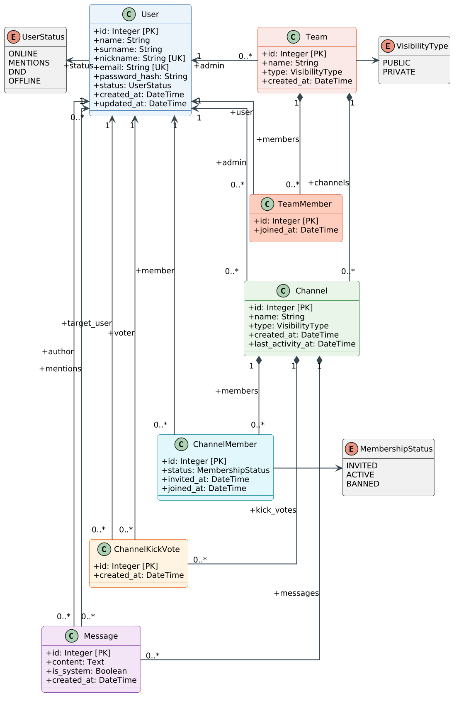

# vpwa_projekt

# Tím:
Denis Gaál - deno555

Jakub Chmura - ChmuraJakub/AutWorld

# Github repozitár:
https://github.com/deno555/vpwa_projekt

# Ukážka návrhu dátového logického modelu v UML notácii

## Prehľad použitých knižníc:

### Frontend (`frontend/chat`):
- **`quasar` (2.33.1):** UI komponenty (QLayout, QHeader, QDrawer, QPage, QInput, QBtn, QAvatar, QBadge, QDialog, QMenu, QChatMessage), pluginy (Notify, Dialog) a responzívny systém.
- **`vue` (3.5.22):** Jadro klientskej aplikácie (Composition API, reaktivita, komponenty).
- **`pinia` (4.0.3):** Globálny state management (používateľ, online/offline stavy, zoznam kanálov, správy, koncepty správ).
- **`vue-router` (5.0.6):** Klientsky routing medzi chatom, prihlásením a registráciou.
- **`socket.io-client` (4.8.4):** WebSocket klient – odosielanie a prijímanie správ v reálnom čase, oznámenia o zmenách kanálov.
- **`@quasar/extras` (2.1.0):** Material Icons a systémové fonty.
- **`@quasar/app-vite` (3.10.0):** Vite vývojový server a build nástroj.

### Backend (`backend/chatBE`):
- **`@adonisjs/core` (7.5.1):** Hlavný MVC backendový TypeScript framework (HTTP server, routing, dependency injection).
- **`@adonisjs/auth` (10.1.0):** Autentifikácia používateľov, hashovanie hesiel a správa access tokenov.
- **`@adonisjs/lucid` (22.4.2):** ORM a migračný systém pre prácu s databázovými modelmi.
- **`mysql2` (3.24.6):** Databázový driver pre MySQL / MariaDB.
- **`@adonisjs/cors` (3.0.0):** CORS middleware pre komunikáciu s frontendom.
- **`socket.io` (4.8.4):** WebSocket server (providers/socket_provider.ts) – správy v kanáloch, história po stránkach a udalosti `teams:changed`.
- **`@adonisjs/session` (8.1.0) & `@adonisjs/shield` (9.0.0):** Správa sessions a bezpečnosť aplikácie.